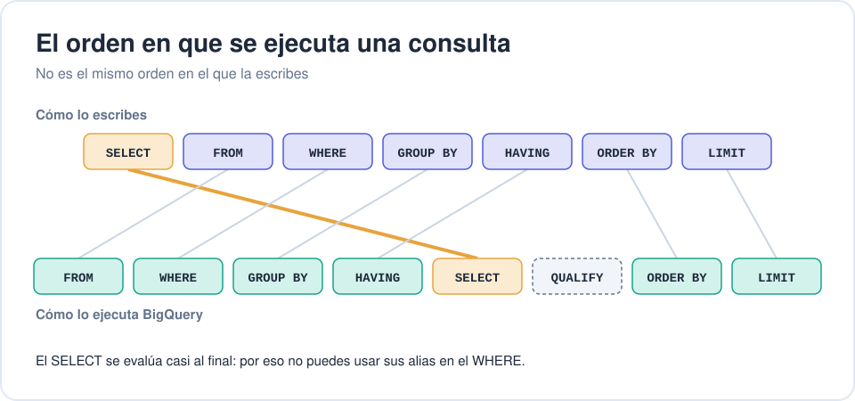
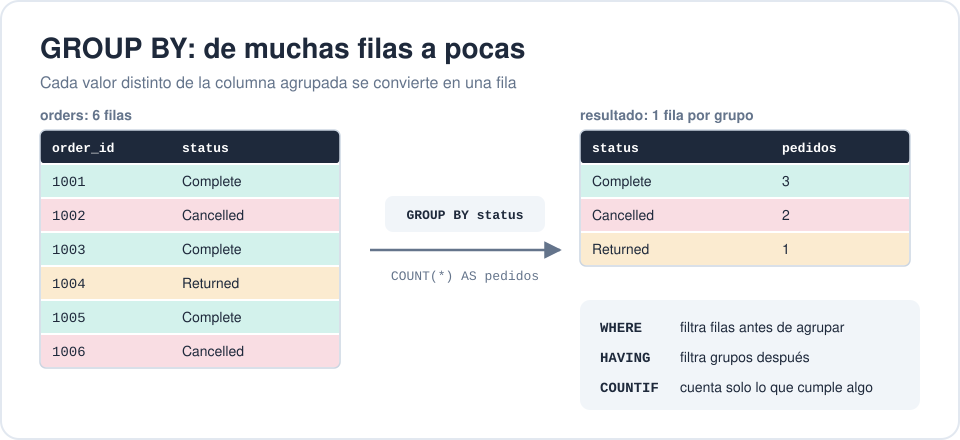
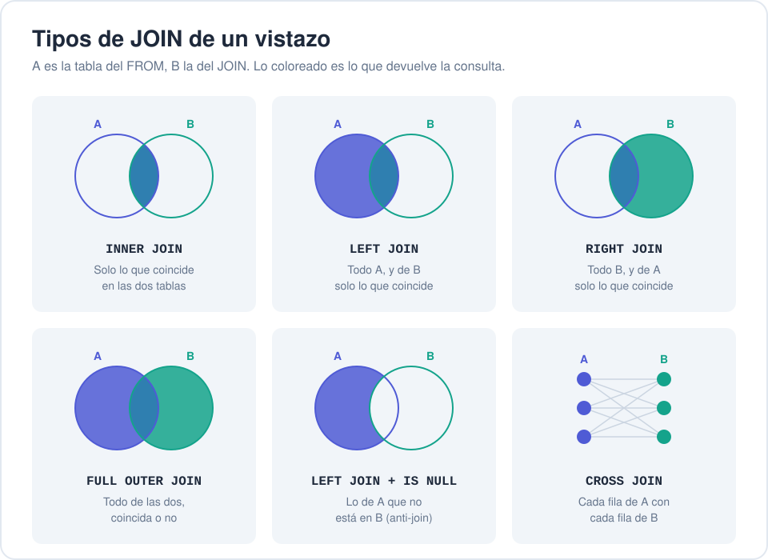
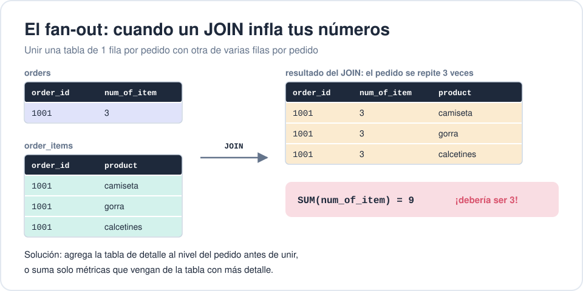
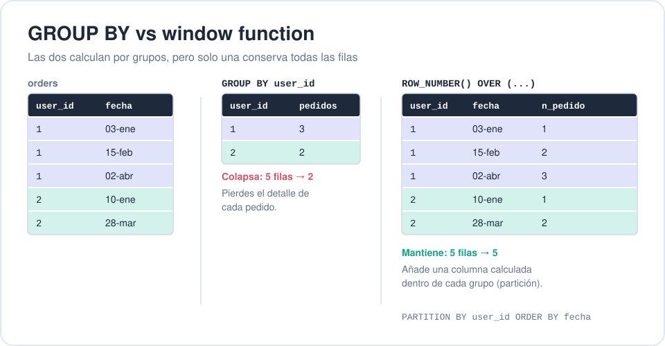
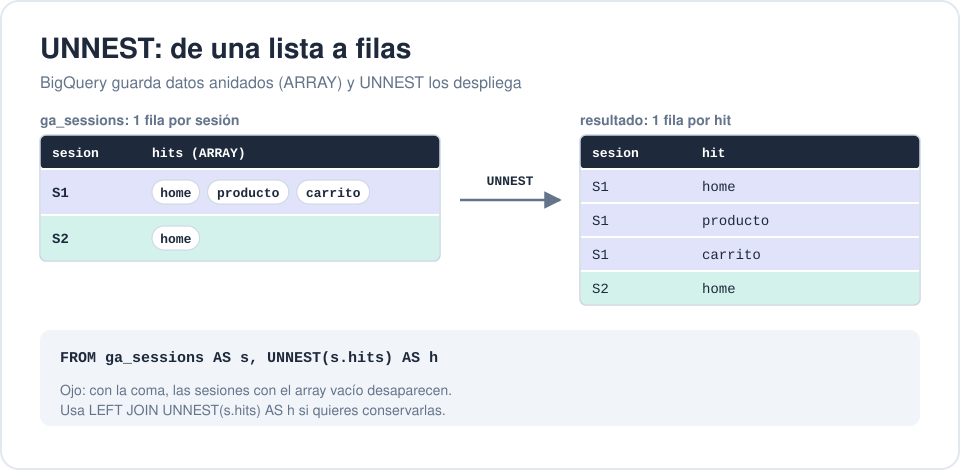
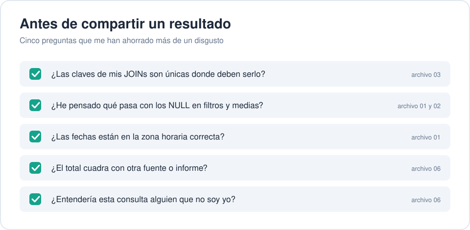

# 🧠 SQL en BigQuery: lo básico que me hubiera gustado saber hace 2 años

Este repo recoge lo que he aprendido trabajando con **SQL en Google BigQuery** durante los últimos dos años: desde lo más básico hasta las técnicas para construir consultas más avanzadas, con ejercicios para practicar cada bloque.

Todos los ejemplos usan **datasets públicos de BigQuery**, así que puedes copiarlos y ejecutarlos tal cual en tu consola, incluso con el [sandbox gratuito](https://cloud.google.com/bigquery/docs/sandbox).

## 📚 Contenido

| # | Archivo | Qué aprenderás |
|---|---------|----------------|
| 01 | [`01_fundamentos.sql`](01_fundamentos.sql) | SELECT, WHERE, tipos de datos, NULLs, fechas, CASE |
| 02 | [`02_agregaciones.sql`](02_agregaciones.sql) | GROUP BY, HAVING, COUNTIF, agregaciones condicionales, SAFE_DIVIDE |
| 03 | [`03_joins.sql`](03_joins.sql) | Tipos de JOIN, anti-joins y el temido "fan-out" (filas duplicadas) |
| 04 | [`04_ctes_y_window_functions.sql`](04_ctes_y_window_functions.sql) | WITH, ROW_NUMBER, LAG/LEAD, acumulados, medias móviles, QUALIFY |
| 05 | [`05_lo_propio_de_bigquery.sql`](05_lo_propio_de_bigquery.sql) | ARRAY, STRUCT, UNNEST, particiones, clustering, tablas comodín |
| 06 | [`06_buenas_practicas.sql`](06_buenas_practicas.sql) | SQL legible, validación de datos y errores típicos a evitar |

## 🏋️ Ejercicios

Cada bloque tiene su archivo de ejercicios en [`ejercicios/`](ejercicios) y sus soluciones comentadas en [`soluciones/`](soluciones).

Los ejercicios son **acumulativos**: los del bloque 1 solo usan lo del bloque 1, los del bloque 2 mezclan lo del 1 y el 2, y así hasta el bloque 6, que termina con un proyecto final donde se usa todo lo del repo.

| Bloque | Ejercicios | Repasa |
|--------|-----------|--------|
| 01 · Fundamentos | [7 ejercicios](ejercicios/01_ejercicios.sql) | bloque 1 |
| 02 · Agregaciones | [7 ejercicios](ejercicios/02_ejercicios.sql) | bloques 1 y 2 |
| 03 · JOINs | [6 ejercicios](ejercicios/03_ejercicios.sql) | bloques 1 a 3 |
| 04 · CTEs y window functions | [7 ejercicios](ejercicios/04_ejercicios.sql) | bloques 1 a 4 |
| 05 · Lo propio de BigQuery | [7 ejercicios](ejercicios/05_ejercicios.sql) | bloques 1 a 5 |
| 06 · Buenas prácticas | [5 ejercicios](ejercicios/06_ejercicios.sql) | todo el repo |

Cada ejercicio indica su dificultad (⭐ básico, ⭐⭐ medio, ⭐⭐⭐ reto), qué bloques repasa y una pista. Intenta resolverlos antes de mirar la solución: hay muchas formas correctas de llegar al mismo resultado.

## 🖼️ Los conceptos clave, de un vistazo

### 01 · Fundamentos
El orden en que escribes una consulta no es el orden en que BigQuery la ejecuta. Entender esto explica muchos errores.

### 02 · Agregaciones
`GROUP BY` convierte muchas filas en una fila por grupo.

### 03 · JOINs
Los seis tipos de unión que más vas a usar:

Y el error que más números ha inflado en reporting:

### 04 · CTEs y window functions
Las window functions calculan por grupos sin perder ninguna fila.

### 05 · Lo propio de BigQuery
BigQuery guarda datos anidados en arrays, y `UNNEST` los convierte en filas.

### 06 · Buenas prácticas
Las preguntas que me hago antes de compartir cualquier número:

## 🗂️ Datasets usados

- `bigquery-public-data.thelook_ecommerce`: un e-commerce ficticio (usuarios, pedidos, productos). Lo uso en casi todos los archivos.
- `bigquery-public-data.google_analytics_sample`: sesiones de Google Analytics con datos anidados (ideal para aprender UNNEST).

## 🚀 Cómo usarlo

1. Abre la [consola de BigQuery](https://console.cloud.google.com/bigquery).
2. Copia cualquier bloque de consulta (están separados por comentarios) y ejecútalo.
3. En los archivos 05 y 06 hay ejemplos que crean tablas: cambia `mi_proyecto.mi_dataset` por tu propio proyecto y dataset.

Cada archivo está pensado para leerse de arriba abajo: los comentarios explican el *por qué*, no solo el *qué*. Los bloques marcados con 💡 son lecciones aprendidas a base de errores.

## 🤝 Contribuciones

¿Echas algo en falta o ves un error? Abre un issue o un PR, encantada de mejorarlo.
